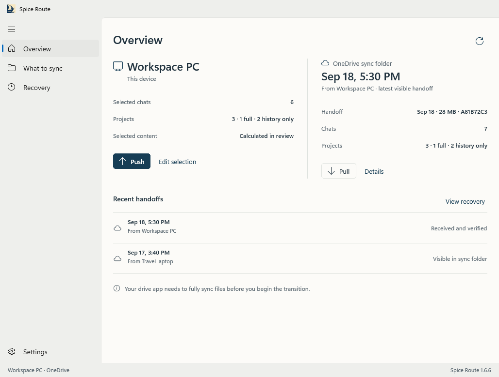
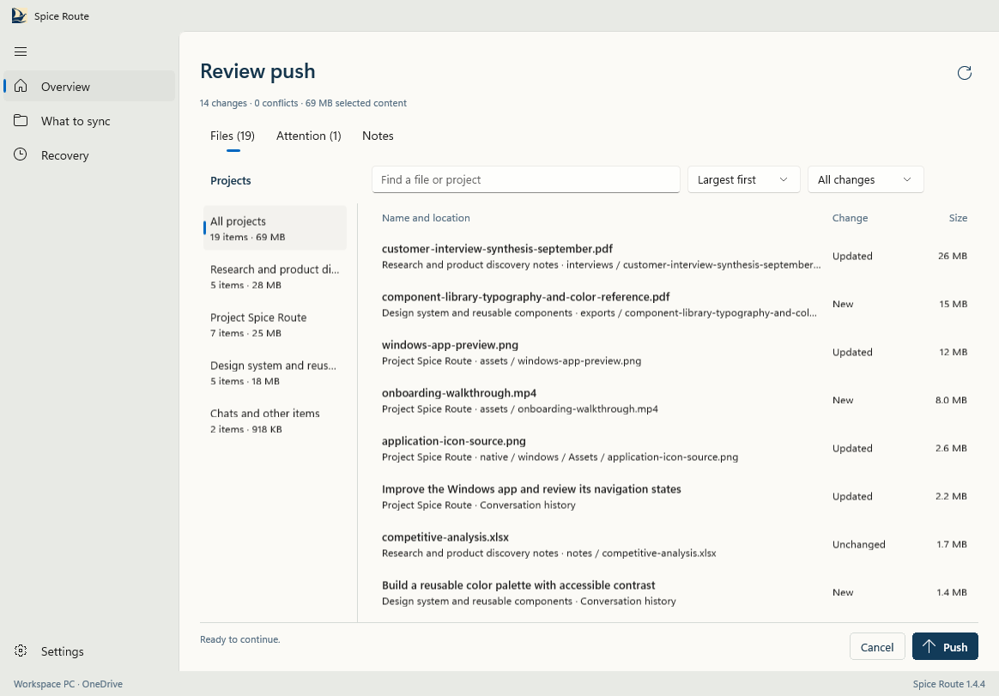

  

# Project Spice Route

**Got multiple devices like I do? Start a project on one PC, and pick up your Codex work on another.**

Spice Route is a desktop app that carries the chats and project work you choose through a folder synced by OneDrive, Google Drive, or iCloud Drive. Bring a whole project, including its files and Git history, or take just the conversations. Your cloud app handles sign-in and delivery.

[Windows x64](https://github.com/desigrit/project-spice-route/releases/download/v1.7.0/Spice-Route-1.7.0-windows-x64-setup.exe) · [Windows ARM64](https://github.com/desigrit/project-spice-route/releases/download/v1.7.0/Spice-Route-1.7.0-windows-arm64-setup.exe) · [Mac, Apple Silicon](https://github.com/desigrit/project-spice-route/releases/download/v1.7.0/Spice-Route-1.7.0-macos-apple-silicon.dmg)

Already on 1.6.8 or later? Find the next version in **Settings > Updates**, then choose **Install and restart**.

Update Spice Route on both computers before your first 1.7 handoff. Pull checks whether the receiving Codex runtime can open the selected chats.

*See what is selected here and compare it with the latest handoff visible in your sync folder.*

<strong>Decisions behind Spice Route: tradeoffs, AI and pushback</strong>

### Product decisions

**Reuse the cloud drive people already have.** I chose OneDrive, Google Drive or iCloud Drive to carry selected chats and project files. That avoids another storage account, but delivery depends on the drive app. **Push** saves a handoff; the user still needs to wait for syncing before **Pull** on the other computer.

**Add review and recovery.** Restoring work can change files and chat history. Spice Route checks incoming content, asks about conflicts and saves a recovery point. It blocks unfamiliar database formats until they are checked. The cost is extra steps, storage and compatibility updates when Codex changes. [How handoffs work](docs/architecture.md)

### How I worked with AI

Codex helped build the app and its transfer tests. I tried handoffs between my devices, reported failures such as duplicate project folders, and asked what would happen to work created only on the receiving computer.

### What I pushed back on

I challenged the claim "This device has the latest handoff." Seeing a handoff locally does not prove another computer has received it. I asked for a side-by-side comparison with the sync folder and a clear reminder to let the drive finish.

I also wanted unrelated work preserved when pulling. A matching project name alone is not enough to combine projects.

### What I would test next

I would keep testing interrupted transfers, two computers changing the same work, repeated pulls and newer Codex versions. Automated checks help, but a release still needs real handoffs between Windows and Mac. [Verification guide](docs/testing-1.6.7.md)

## Choose what travels

Select individual chats and give each project its own setting: **Full project**, **Chat history only**, or **Excluded**. A project can include several code folders, even when they live in different places on your computer.

## Make a handoff

1. Install Spice Route on both computers. Choose a dedicated cloud drive folder that syncs between them.
2. Choose your Codex tasks and history folder, usually `.codex`, then select the chats and project folders you want to carry. If you use a separate folder for projectless chat working files, choose that too. Codex’s internal `.codex/sessions` folder is already covered by that selection.
3. On the computer you are leaving, choose **Push** and review the handoff. Wait for your drive app to finish syncing.
4. On the other computer, match the handoff ID, choose **Pull**, review any conflicts, and continue in Codex.

*Review chats and files before publishing or restoring a handoff.*

Spice Route checks the content it receives and keeps a local recovery point before a Pull changes files. Your Codex settings and credentials stay on each computer. A handoff visible in a sync folder may still be downloading, so check your drive app before switching devices.

Want a closer look? Follow the [visual handoff guide](docs/handoff-walkthrough.md). For setup and technical details, see the [architecture notes](docs/architecture.md) and [verification guide](docs/testing-1.6.7.md). If something goes wrong, [tell us what happened](https://github.com/desigrit/project-spice-route/issues).

Spice Route is an independent project, not an official OpenAI product. Windows installers are unsigned; the Mac package is ad-hoc signed and not notarized. There is no app-level encryption.
